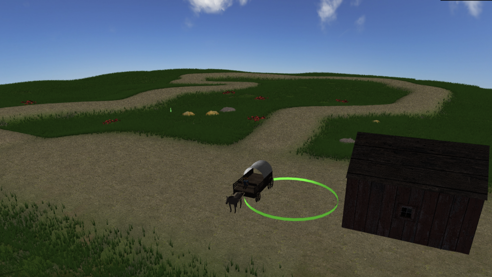
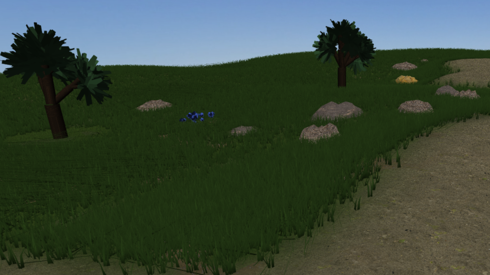
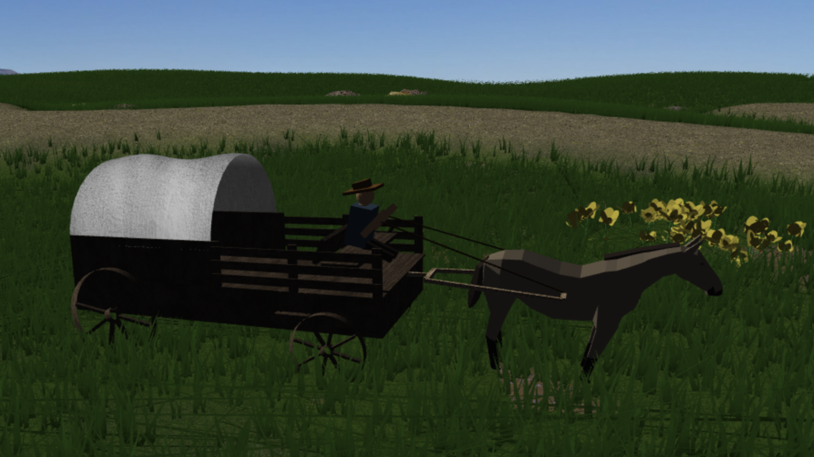

# Wagon Rush

Interactive 3D survival game built with JavaScript, WebGL and GLSL for the Computer Graphics course at FEUP (2025/2026). Drive a horse-drawn wagon, collect hay bales and deliver them to the barn to restore health while avoiding obstacles.



## Features

- Heightmap terrain, procedural vegetation and custom shaders for wind, clouds and surface blending.
- Animated wagon and horse, collision feedback and terrain-aware movement.
- Hay collection and delivery, health management, score tracking and restart.
- Mesh batching for vegetation rendering, follow camera and free camera.

## Screenshots

| Terrain and vegetation | Wagon close-up |
| --- | --- |
|  |  |

[View the animation](project/screenshots/delivery/project-t01g05-4.gif).

## Run locally

From the repository root, start a static HTTP server:

```bash
python -m http.server 8000
```

Open <http://localhost:8000/project/> in a browser with WebGL 2 support. The libraries and resources are included; no package installation is required.

## Controls

| Key | Action |
| --- | --- |
| Space | Start |
| W / S | Accelerate / brake |
| A / D | Steer |
| P / L | Pick up / drop a hay bale |
| R | Restart after game over |
| F | Toggle free camera |

## Documentation and credits

See the [project README](project/README.md) for implementation details, limitations and the AI use declaration. Course exercises remain in `tp1`–`tp5`.

Built with FEUP's WebCGF framework and dat.GUI.

**Authors:** Gonçalo Ferreira, João Santos and João Furtado.
