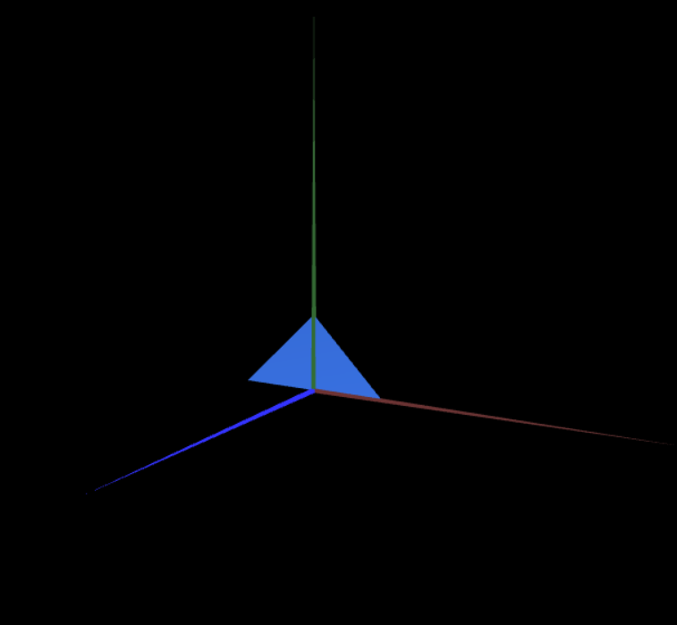
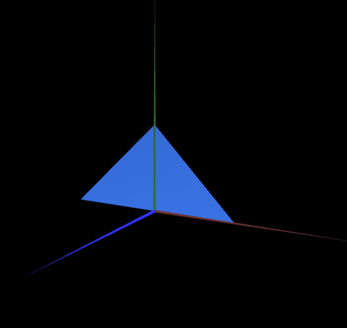

# CG 2025/2026

## Group T01xG05

## TP 1 Notes

In exercise 1.1, we learned how to use the WebGL pipeline to render a simple triangle. By using MyDiamond as a template we saw how we could set up another object, giving the vertices coordinates and initializing the buffers. 
Finally, we were able to render the triangle on the screen, by going to MyScene.js, initializing the object and on the display function calling the display method of the triangle.

In exercise 1.2, we had some trouble figuring out how dat.GUI works, but following the implementation of displayAxis we were able to learn how to add checkboxes to the interface and link them to the display of objects in the scene. 
We added a checkbox for the triangle, and when we checked it, the triangle appeared on the screen, and when we unchecked it, it disappeared.

Exercise 1.3 was a bit more challenging than the rest, as it required us to understand how the triangles are rendered in WebGL. We had to figure out how to make it double-sided, which means that it would be visible from both sides. 
We achieved this by connecting the vertices in anti-clockwise and clockwise order, which made the triangle visible from both sides.

Exercise 2 was pretty much just applying what we learned in exercise 1. We created to new objects, defined the vertices and indices for each of them, and then initialized the buffers. 
Then we just changed the MyScene.js file to initialize the new objects and call their display methods in the display function. It was a good exercise to practice what we learned in exercise 1 and to see how we can create more complex objects by defining more vertices and indices.

