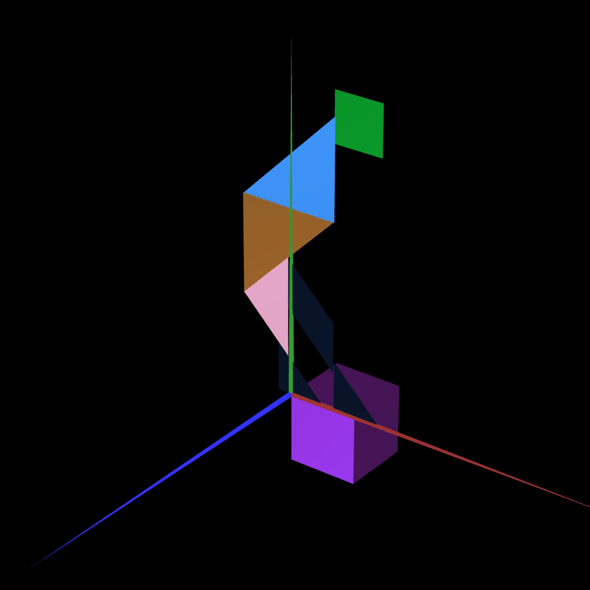

# CG 2025/2026

## Group T01xG05

## TP 2 Notes

In exercise 4, instead of building a cube all at once, we created it using 6 separate planes. We made a MyQuad class for a basic square and then reused it 6 times in MyUnitCubeQuad. By applying different translations and rotations to the same square, we positioned them to form the 6 faces of the unit cube. 

Figuring out the exact rotation angles (especially the -90 and 90 degrees for the top and bottom faces) was a bit confusing at first, but we got the hang of it. Finally, we updated MyScene.js to replace the old cube with this new composed one, keeping it behind our Tangram figure.

