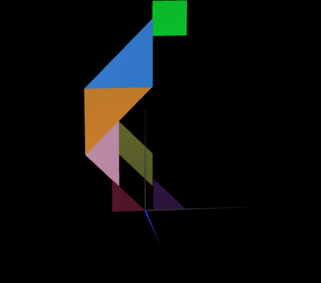
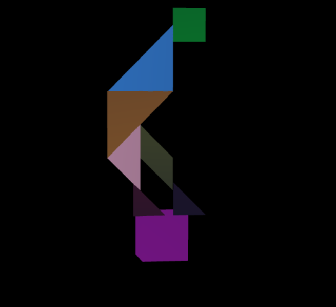

# CG 2025/2026

## Group T01xG05

## TP 2 Notes

In exercise 2, given the picture of the tangram attributed to our group, we had to create the tangram figure using the classes we had previously defined. We started instantiating the different shapes (triangles, diamonds, and parallelogram) and then applied the necessary transformations (translations, rotations, and scaling) to position them correctly. It was a bit tricky to get all the angles and positions right, but we managed to recreate the tangram figure accurately.

In exercise 3, we had to create a new class called MyUnitCube, which represents a cube with sides of length 1. We defined the vertices and indices for the cube, and then we implemented the display method to render it. It was a good exercise to further understand how to define the indices in 3D space, since we had to use different methods depending on the side we were building.

In exercise 4, instead of building a cube all at once, we created it using 6 separate planes. We made a MyQuad class for a basic square and then reused it 6 times in MyUnitCubeQuad. By applying different translations and rotations to the same square, we positioned them to form the 6 faces of the unit cube. 

Figuring out the exact rotation angles (especially the -90 and 90 degrees for the top and bottom faces) was a bit confusing at first, but we got the hang of it. Finally, we updated MyScene.js to replace the old cube with this new composed one, keeping it behind our Tangram figure.

