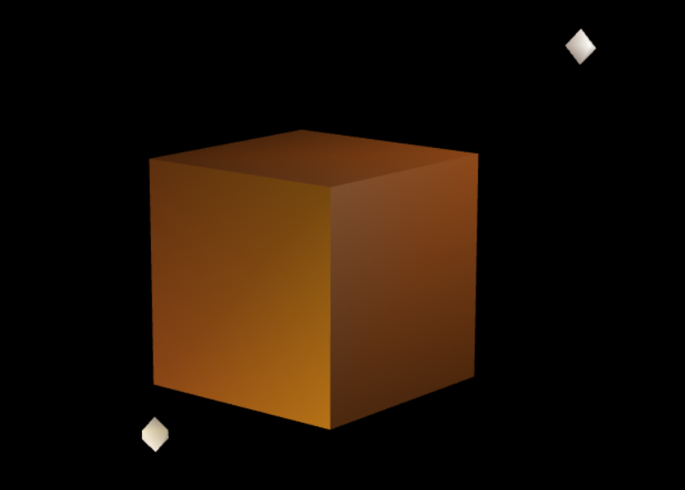
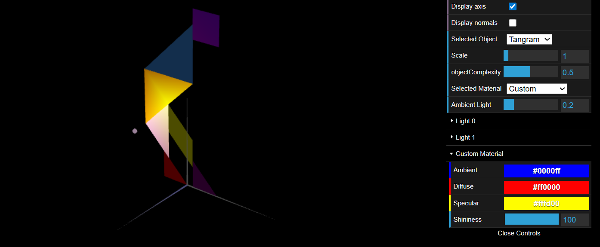
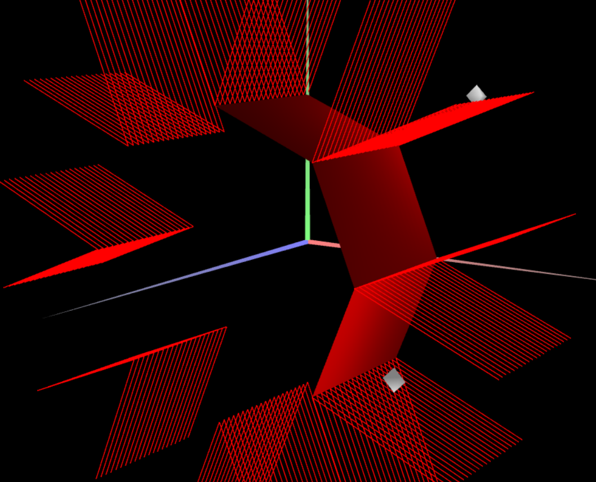
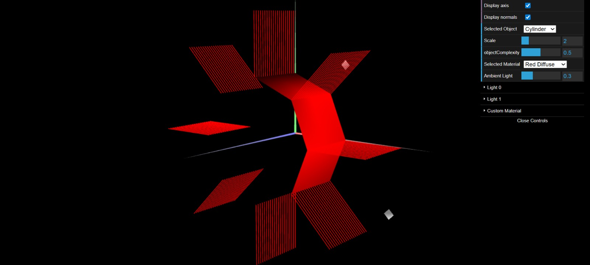

# CG 2025/2026

## Group T01xG05

## TP 3 Notes

In the first part of this assignment, we updated the shapes we had previously defined (triangles, diamonds, and parallelograms) by adding normal vectors (`this.normals`). We also updated the `MyUnitCube` class. It was a good exercise to further understand how lighting affects surfaces in 3D space, since we had to define 24 vertices instead of 8. By grouping 4 vertices per face and duplicating them where they meet, we ensured each side possessed its own perpendicular normal vector. This allowed us to keep the sharp edges of the cube instead of having them smoothed out by the lighting. We also created a wood-like material in our scene to test on these objects.

Next, instead of just defining raw colors, we created and applied materials (`CGFappearance`) to our Tangram figure. In `MyTangram.js`, we instantiated specific materials for each piece by defining their ambient, diffuse, and specular components, as well as their shininess. Furthermore, as requested, we applied the `Custom` material to the `MyDiamond` sub-piece, allowing its lighting properties to be dynamically controlled via the user interface.

Finally, we created a new class called `MyPrism`. Instead of hardcoding the vertices like we did for the previous shapes, we generated the prism algorithmically based on a given number of `slices` and `stacks`. We used trigonometric functions to calculate the coordinates and the normal vectors for each face. To ensure the prism had flat faces (Constant Shading) rather than a smoothed cylindrical appearance, we duplicated the vertices at the edges so that each face could maintain its strictly perpendicular normal vectors. Using the interface's normal visualization feature was a great help to debug and verify that all our normal vectors were pointing in the right directions.

In exercise 3, to conclude the tp3, we created the `MyCylinder` class based on our prism implementation. However, to achieve a smooth, curved appearance (Gouraud shading) instead of flat faces, we changed how the vertices and normals are handled. We stopped duplicating vertices at the edges, meaning adjacent faces now share the same vertex. Furthermore, we set the normal of each vertex to point radially outward from the center of the cylinder. This approach smooths out the lighting transitions across the edges.

